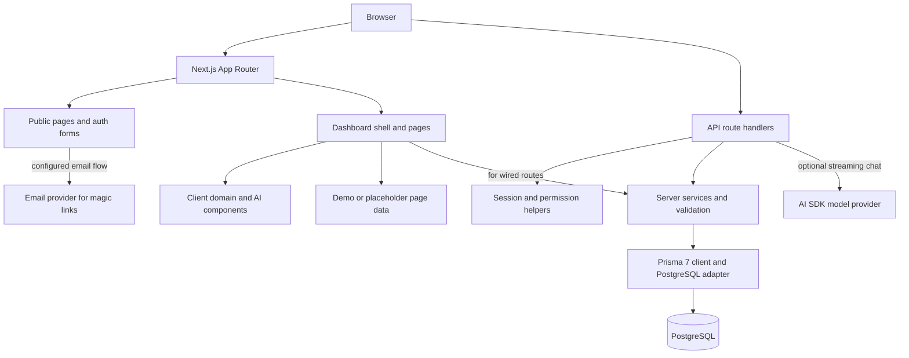
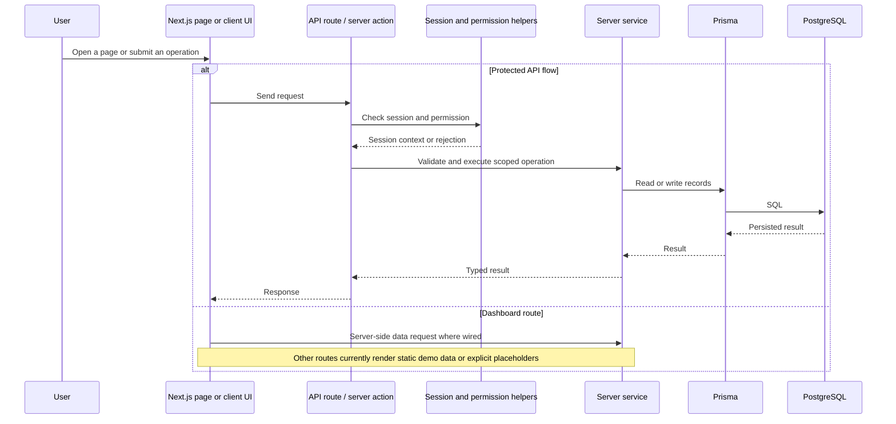
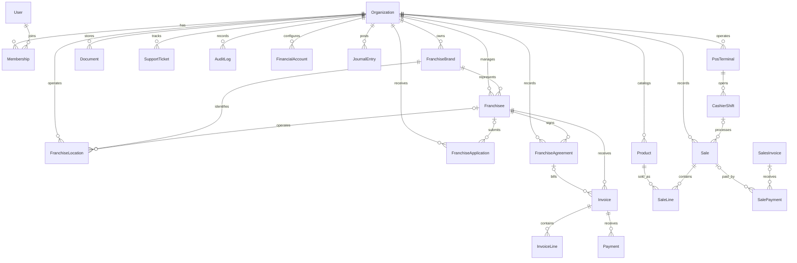

<p align="center">
  
</p>

<h1 align="center">Franchise Management</h1>

<p align="center">
  <a href="https://nextjs.org/"></a>
  <a href="https://react.dev/"></a>
  <a href="https://www.typescriptlang.org/"></a>
  <a href="https://www.prisma.io/"></a>
  <a href="./LICENSE"></a>
</p>

Franchise Management is a multi-tenant franchise operations application built with the Next.js App Router, Prisma, and PostgreSQL. It contains working database-backed slices alongside UI scaffolds and demo content; the status distinctions below describe the current implementation rather than the intended product.

> **Development status:** This is not yet a production-complete system. Some dashboard routes use demo identity or static content, and some navigation destinations are placeholders. Do not treat client-side visibility or the current demo shell as authorization.

## What exists today

| Area | Current state |
| --- | --- |
| Authentication | Login, signup, password, and magic-link code paths exist. API routes that perform protected operations check the current session. Dashboard identity/organization context is still demo or placeholder in some pages. |
| Franchise operations | Prisma-backed list/detail pages exist for brands, franchisees, locations, applications, and agreements. Several create/edit actions and form components are not connected to persisted workflows. |
| Finance | Invoice and payment records are persisted. Finance overview, invoice list/detail, and payment list read persisted data. Royalty, tax, payment-entry, and reconciliation components are not all connected to page flows. |
| Point of sale | Product lookup, sale creation, and refund services/API routes use Prisma data. The POS workspace has client-local cart/register state; inventory quantities and persistent register-session behavior are not fully integrated. |
| Documents, support, audit | Document listing, support ticket listing, and audit-log listing use existing Prisma models. Upload/version-management flows and some detail/actions remain incomplete. |
| AI assistant | A streaming chat route and assistant page exist. A model is optional and configured by environment. The assistant does not currently have a grounded data-retrieval workflow and cannot apply business decisions. |
| Workflows, notifications, reporting | Dashboard routes and domain UI components exist, but the schema currently has no persistence models for approvals, notifications, saved reports, or scheduled reports. These routes display unavailable/empty states. |
| Inventory, HR, compliance | Product catalog data exists, but stock-control models are absent. HR and compliance domain components are scaffolds; there are no corresponding dashboard flows or Prisma models yet. |
| Settings and overview | Settings is a placeholder. The dashboard overview contains hard-coded sample KPIs and applications rather than live aggregates. |

No sample operational business data is seeded. `prisma/seed.ts` only upserts an organization when both organization seed environment variables are supplied.

## Application routes

### Public

| Route | Current purpose |
| --- | --- |
| `/` | Public landing page |
| `/login` | Login form |
| `/signup` | Organization/account signup form |
| `/auth/magic-link` | Magic-link callback flow |

### Dashboard

| Route | Current data/behavior |
| --- | --- |
| `/dashboard` | Static overview metrics and sample applications |
| `/dashboard/franchises` and `/dashboard/franchises/[id]` | Franchisee list and detail from Prisma |
| `/dashboard/applications` and `/dashboard/applications/[id]` | Application list and detail |
| `/dashboard/agreements` and `/dashboard/agreements/[id]` | Agreement list and detail |
| `/dashboard/brands` and `/dashboard/brands/[id]` | Brand list and detail |
| `/dashboard/locations` and `/dashboard/locations/[id]` | Location list and detail |
| `/dashboard/finance` | Invoice totals and invoice table |
| `/dashboard/finance/invoices` and `/dashboard/finance/invoices/[id]` | Invoice list and detail |
| `/dashboard/finance/payments` | Payment record list |
| `/dashboard/pos` | POS workspace using the product catalog |
| `/dashboard/documents` | Organization document list |
| `/dashboard/support` and `/dashboard/support/[id]` | Support tickets |
| `/dashboard/audit` | Recent audit log entries |
| `/dashboard/ai` | Streaming assistant UI |
| `/dashboard/notifications` | Placeholder; notification persistence is absent |
| `/dashboard/workflows` | Placeholder; approval persistence/decision flow is absent |
| `/dashboard/reporting` | Placeholder; report persistence is absent |
| `/dashboard/settings` | Placeholder settings page |
| `/dashboard/preview` | Embedded application preview |

### API routes

| Endpoint | Current purpose |
| --- | --- |
| `POST /api/ai/chat` | Permission-checked streaming assistant response; returns unavailable when no model is configured |
| `/api/auth/magic-link` | Magic-link authentication endpoints |
| `/api/auth/password-reset` | Password reset endpoints |
| `GET /api/pos/products` | Session-scoped product search |
| `POST /api/pos/sales` | Session-scoped POS sale creation |
| `POST /api/sales` | Sale creation |
| `POST /api/sales/refunds` | Refund creation |

## Architecture

The application uses server-rendered App Router pages for database access and client components for interactive tables, forms, and AI/POS interfaces. The following diagram distinguishes persisted data paths from static or scaffolded dashboard content.



### Request and data flow

Protected API handlers obtain the current session and pass organization context to server services. Dashboard pages are less uniform: some use these services, some query Prisma directly, and others still use demo/static data. Authorization must be enforced on the server; navigation visibility is only presentation.



### Persisted domain model overview

The schema includes organization membership, franchise operations, documents/support/audit, accounting, and sales/POS models. It does not yet include inventory stock, HR, compliance records, notifications, approvals/workflows, or saved/scheduled reports.



## Technology

- Node.js `>=24.21.0` and pnpm `12.23.0`
- Next.js 16 App Router, React 19, and TypeScript 7
- PostgreSQL with Prisma 7 and `@prisma/adapter-pg`
- Tailwind CSS 4 and Radix/shadcn-style UI primitives
- Vercel AI SDK (`ai`) for optional streamed responses
- Vitest, Testing Library, and jsdom

## Local development

### Prerequisites

- Node.js `>=24.21.0`
- pnpm `12.23.0` (the repository package manager)
- A PostgreSQL database

### Setup

```bash
pnpm install
```

Copy `.env.example` to `.env.local` and set at least `DATABASE_URL` and an `AUTH_SECRET` of at least 16 characters for authenticated flows.

On macOS/Linux:

```bash
cp .env.example .env.local
```

On PowerShell:

```powershell
Copy-Item .env.example .env.local
```

Then validate/generate the Prisma client, apply local development migrations, and start Next.js:

```bash
pnpm prisma:validate
pnpm prisma:generate
pnpm prisma:migrate
pnpm dev
```

Open <http://localhost:3000>.

The seed command is optional. It inserts no data unless both `SEED_ORGANIZATION_NAME` and `SEED_ORGANIZATION_SLUG` are set; then it upserts only that organization. It does not generate users, example franchises, or sample transactions.

### Environment variables

| Variable | Use |
| --- | --- |
| `DATABASE_URL` | PostgreSQL runtime connection |
| `DIRECT_DATABASE_URL`, `PRISMA_DATABASE_URL`, `POSTGRES_URL_NON_POOLING`, `POSTGRES_URL`, `DATABASE_URL_POOLED` | Supported database URL aliases (resolved by Prisma/runtime configuration) |
| `SHADOW_DATABASE_URL` | Optional Prisma shadow database |
| `AUTH_SECRET` | Session signing secret; at least 16 characters for authenticated sessions |
| `APP_URL` | Application URL; defaults to `http://localhost:3000` |
| `EMAIL_FROM`, `RESEND_API_KEY`, `MAGIC_LINK_TTL_MINUTES` | Magic-link email configuration |
| `AI_DEFAULT_MODEL` and provider credentials | Optional AI assistant model configuration |
| `SEED_ORGANIZATION_NAME`, `SEED_ORGANIZATION_SLUG` | Optional real organization bootstrap; set both or neither |

See `.env.example` for local placeholders. Never commit secrets or real credentials.

## Useful commands

| Command | Purpose |
| --- | --- |
| `pnpm dev` | Start the development server |
| `pnpm build` | Create a production build |
| `pnpm typecheck` | Run TypeScript without emitting files |
| `pnpm lint` | Run ESLint |
| `pnpm lint:fix` | Apply automatic ESLint fixes |
| `pnpm format` | Format TypeScript, JavaScript, JSON, and Markdown files |
| `pnpm format:check` | Check formatting |
| `pnpm test` | Run the Vitest suite once |
| `pnpm test:watch` | Run Vitest in watch mode |
| `pnpm prisma:validate` | Validate the Prisma schema |
| `pnpm prisma:generate` | Generate the Prisma client |
| `pnpm prisma:migrate` | Create/apply a local development migration |
| `pnpm prisma:migrate:deploy` | Apply existing migrations in deployment environments |
| `pnpm prisma:studio` | Open Prisma Studio |
| `pnpm db:seed` | Run the conditional organization-only seed |
| `pnpm inventory:audit` | Check component inventory governance |
| `pnpm check` | Run lint, typecheck, tests, and inventory audit |

## Repository map

```text
app/
  api/                 API route handlers (AI, auth, POS, sales)
  auth/                Authentication callbacks
  dashboard/           Dashboard pages and nested detail routes
  login/ signup/       Public account flows
components/
  ai-elements/         AI interaction primitives
  domain/              Domain UI grouped by business area
  ui/                  Reusable UI primitives
  layout/ dashboard/   App shell and dashboard presentation
lib/
  server/              Auth, services, validation, and server-only data access
  rbac.ts               Permission catalog
prisma/
  schema.prisma         Persisted domain schema
  migrations/           Database migration history
  seed.ts                Optional organization-only seed
tests/                  Vitest and Testing Library tests
docs/                   Component architecture and remediation status
```

Component boundaries, inventory requirements, and implementation status are documented in [components/README.md](./components/README.md), [docs/component-inventory.md](./docs/component-inventory.md), and [docs/component-remediation-status.md](./docs/component-remediation-status.md).

## Security and contribution

Read [SECURITY.md](./SECURITY.md) before reporting a vulnerability and [CONTRIBUTING.md](./CONTRIBUTING.md) before opening a change. Server-side authorization is required for protected operations; UI or navigation filtering is not an authorization boundary. Current demo identity/context usage means the dashboard should not be considered production-secure until that integration is completed.

Community participation is governed by [CODE_OF_CONDUCT.md](./CODE_OF_CONDUCT.md).

## License

This project is released under the MIT License. See [LICENSE](./LICENSE).
