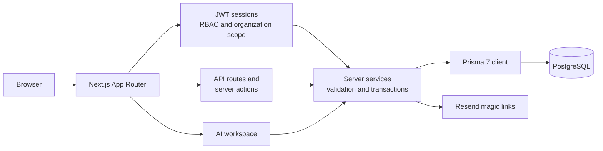
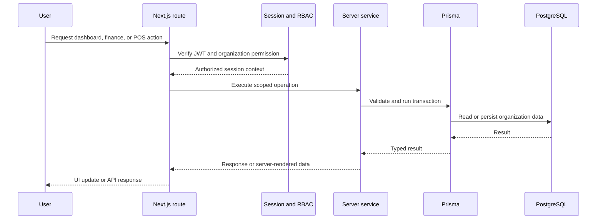

<p align="center">
  
</p>

<h1 align="center">Franchise Management</h1>

<p align="center">
  <a href="https://nextjs.org/"></a>
  <a href="https://react.dev/"></a>
  <a href="https://www.typescriptlang.org/"></a>
  <a href="https://www.prisma.io/"></a>
  <a href="./LICENSE"></a>
</p>

Franchise Management is a multi-tenant Next.js application for operating franchise organizations, brands, franchisees, locations, applications, finance, point of sale, and assisted workflows.

The current application is an actively developed foundation. Authentication, organization-scoped authorization, franchise management, applications, finance, point of sale, an AI workspace, and settings are implemented. The Prisma schema also includes the broader domain model for agreements, documents, support, accounting, sales, and audit history; individual workflows continue to be expanded incrementally.

## Current application surface

| Route                         | Purpose                                                                         |
| ----------------------------- | ------------------------------------------------------------------------------- |
| `/`                           | Public landing page                                                             |
| `/login`                      | Password sign-in and magic-link entry                                           |
| `/signup`                     | Account and organization signup                                                 |
| `/dashboard`                  | Authenticated overview with dashboard metrics and recent activity               |
| `/dashboard/franchises`       | Franchise brands, franchisees, and locations                                    |
| `/dashboard/applications`     | Franchise application list and details                                          |
| `/dashboard/finance`          | Finance overview                                                                |
| `/dashboard/finance/invoices` | Invoice management                                                              |
| `/dashboard/finance/payments` | Payment management                                                              |
| `/dashboard/pos`              | Product search, cart calculation, split payments, sales, and printable receipts |
| `/dashboard/ai`               | Permission-protected AI assistant workspace                                     |
| `/dashboard/settings`         | Application settings                                                            |
| `/dashboard/preview`          | Embedded dashboard and POS preview                                              |

The corresponding API routes currently include AI chat, POS product search, sales, and refunds under `app/api/`.

## Architecture



## Authenticated request flow



## Technology

- Next.js 16 App Router with React 19 and TypeScript 7
- Node.js `>=22.23.4`
- PostgreSQL with Prisma 7 and the PostgreSQL adapter
- Tailwind CSS 4 with shadcn/ui-style Radix components
- Stateless JWT sessions in secure `httpOnly` cookies
- bcrypt password hashing, magic-link authentication through Resend, and server-side permission checks
- Vitest with Testing Library for automated tests

## Local setup

Prerequisites: Node.js `>=22.23.4`, PostgreSQL, and pnpm. npm is also supported because the repository includes an npm lockfile.

Install dependencies:

```bash
pnpm install
```

Copy the example environment file to `.env.local` and set the database connection and a random `AUTH_SECRET` with at least 16 characters. Do not commit local environment files or credentials.

On macOS/Linux:

```bash
cp .env.example .env.local
```

On PowerShell:

```powershell
Copy-Item .env.example .env.local
```

Initialize and start the application:

```bash
pnpm prisma:validate
pnpm prisma:generate
pnpm prisma:migrate
pnpm db:seed
pnpm dev
```

Open <http://localhost:3000>.

The seed command intentionally inserts no data unless both `SEED_ORGANIZATION_NAME` and `SEED_ORGANIZATION_SLUG` are set. When both are present, it upserts that organization. It does not create default users or sample business records.

### Environment configuration

Required for normal local development:

- `DATABASE_URL` — PostgreSQL connection string.
- `AUTH_SECRET` — at least 16 random characters for authenticated sessions.

The example file also includes `APP_URL`, `EMAIL_FROM`, `RESEND_API_KEY`, and `MAGIC_LINK_TTL_MINUTES` for magic-link authentication, plus optional seed organization values. For the AI workspace, configure `AI_DEFAULT_MODEL` and the credentials required by the selected AI provider. Database URL aliases such as `DIRECT_DATABASE_URL`, `PRISMA_DATABASE_URL`, and `POSTGRES_URL_NON_POOLING` are supported by the Prisma configuration where applicable.

## Useful commands

| Command                      | Purpose                                              |
| ---------------------------- | ---------------------------------------------------- |
| `pnpm dev`                   | Start the development server                         |
| `pnpm build`                 | Create a production build                            |
| `pnpm start`                 | Serve a production build                             |
| `pnpm typecheck`             | Run TypeScript without emitting files                |
| `pnpm lint`                  | Run ESLint                                           |
| `pnpm lint:fix`              | Apply automatic ESLint fixes                         |
| `pnpm format`                | Format source and documentation files                |
| `pnpm format:check`          | Check Prettier formatting                            |
| `pnpm test`                  | Run the Vitest suite once                            |
| `pnpm test:watch`            | Run Vitest in watch mode                             |
| `pnpm prisma:validate`       | Validate the Prisma schema                           |
| `pnpm prisma:generate`       | Generate the Prisma client                           |
| `pnpm prisma:migrate`        | Create and apply a development migration             |
| `pnpm prisma:migrate:deploy` | Apply existing migrations in deployment environments |
| `pnpm prisma:studio`         | Open Prisma Studio                                   |
| `pnpm db:seed`               | Run the conditional organization seed                |

## Repository layout

- `app/` — Next.js routes, layouts, pages, API routes, and server actions
- `components/` — reusable UI, layout, dashboard, auth, permission, chart, and AI components
- `lib/` — environment validation, Prisma access, navigation, RBAC, validation, and server services
- `prisma/` — schema, migrations, Prisma configuration, and seed entry point
- `tests/` — Vitest and Testing Library tests
- `public/` — static assets
- `docs/` — implementation plans and boundary/audit notes

## Security and contribution

Read [SECURITY.md](./SECURITY.md) before reporting a vulnerability and [CONTRIBUTING.md](./CONTRIBUTING.md) before opening a change. Authorization is enforced on the server; UI visibility is not a security boundary. Community participation is governed by [CODE_OF_CONDUCT.md](./CODE_OF_CONDUCT.md).

## License

This project is released under the MIT License. See [LICENSE](./LICENSE).
